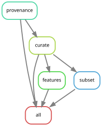

# Salmonella AMR: resistome profiling and machine-learning prediction (One Health)

**Status: work in progress. Data curation, validation and the feature table are done. Baseline, statistics, machine learning, figures and the report are next.**

## Goal
Compare a rule-based baseline (AMRFinderPlus genes and mutations) with machine-learning models for predicting antimicrobial resistance in *Salmonella enterica*, using public NCBI Pathogen Detection data, and test how well models trained on food, animal and environmental isolates transfer to human clinical isolates. Full plan: [`docs/00_project_charter.md`](docs/00_project_charter.md).

## Data
- Source: NCBI Pathogen Detection, Isolates Browser, *Salmonella enterica* isolates with laboratory antibiotic results (tetracycline, ampicillin, ceftriaxone; ciprofloxacin descriptive only).
- After curation: 9,783 isolates with a genome assembly (288 human clinical, 9,495 non-clinical); 9,242 form the primary dataset (one AMRFinderPlus software and database version).
- Antibiotic results are submitter-supplied and not vetted by NCBI beyond basic quality control. About 97% of isolates are from the USA, and the non-clinical group is mostly poultry.
- Exact queries, row counts and checksums: [`docs/data_provenance.md`](docs/data_provenance.md). Curation counts: [`reports/curation_report.md`](reports/curation_report.md).

## Validation done so far
Our own AMRFinderPlus run (software 4.2.7, database 2026-10-29.1) on 300 isolates gave the same set of resistance elements as NCBI's stored results for 295 of 300 isolates (98.3%). Details: [`reports/amrfinder_concordance.md`](reports/amrfinder_concordance.md).

## Workflow


| Step | Script | Output |
|---|---|---|
| Log and check raw data | `00_log_data_provenance.py` | `docs/data_provenance.md` |
| Curate metadata and labels | `01_curate_metadata.py` | `data/processed/metadata_curated.tsv`, `reports/curation_report.md` |
| Pick a 300-isolate check subset | `02_select_subset.py` | `data/processed/subset_300.tsv` |
| Compare local AMRFinderPlus run with NCBI | `03_compare_amrfinder.py` | `reports/amrfinder_concordance.md` |
| Build the resistance-element table | `04_build_features.py` | `data/processed/features_presence.tsv`, `reports/feature_report.md` |

Downloading genomes and running AMRFinderPlus are separate, slower steps (`setup_wsl.sh`, `run_amrfinder_subset.sh`).

## How to reproduce
1. Clone this repository.
2. Download the six tables listed in `config/download_manifest.tsv` from the Isolates Browser (all columns ticked, tab-delimited) into `data/raw/`.
3. **Linux or WSL:**
   ```
   mamba env create -f envs/step4_amr.yml
   conda activate salmonella-amr-tools
   snakemake --cores 1
   ```
   **Windows without WSL** (needs Python with pandas, numpy and pytest):
   ```
   python workflow/scripts/update_docs.py
   python workflow/scripts/02_select_subset.py
   ```
4. Optional local AMRFinderPlus check (Linux or WSL, needs internet, about an hour):
   ```
   bash workflow/scripts/setup_wsl.sh
   bash workflow/scripts/run_amrfinder_subset.sh full
   snakemake --cores 1 concordance_report
   ```
5. Run the tests: `python -m pytest -q tests`

Environment versions are not pinned yet; they will be pinned and recorded before the first release.

## Repository layout
| Folder | Purpose |
|---|---|
| `config/` | Workflow settings and the download manifest |
| `data/` | Raw, interim and processed data (not committed) |
| `workflow/` | Snakemake workflow and scripts |
| `tests/` | Automated tests |
| `reports/` | Auto-generated reports |
| `docs/` | Charter, feasibility notes, data log, workflow diagram |
| `envs/` | Environment files |
| `notebooks/`, `results/` | Reserved for analysis and figures |

## Known limitations
- Laboratory results are submitter-supplied; the test method is not in the table.
- Isolates are heavily clustered, so isolate counts overstate independent evidence. All validation will be grouped by SNP cluster.
- The human clinical group is small (ceftriaxone: 45 resistant isolates in the primary dataset), so uncertainty will be wide.
- Data are mostly American, so conclusions apply to US surveillance data. The workflow is designed to be re-run on other data.

## Author
Rushabh Wakade

## License
MIT (see `LICENSE`).
